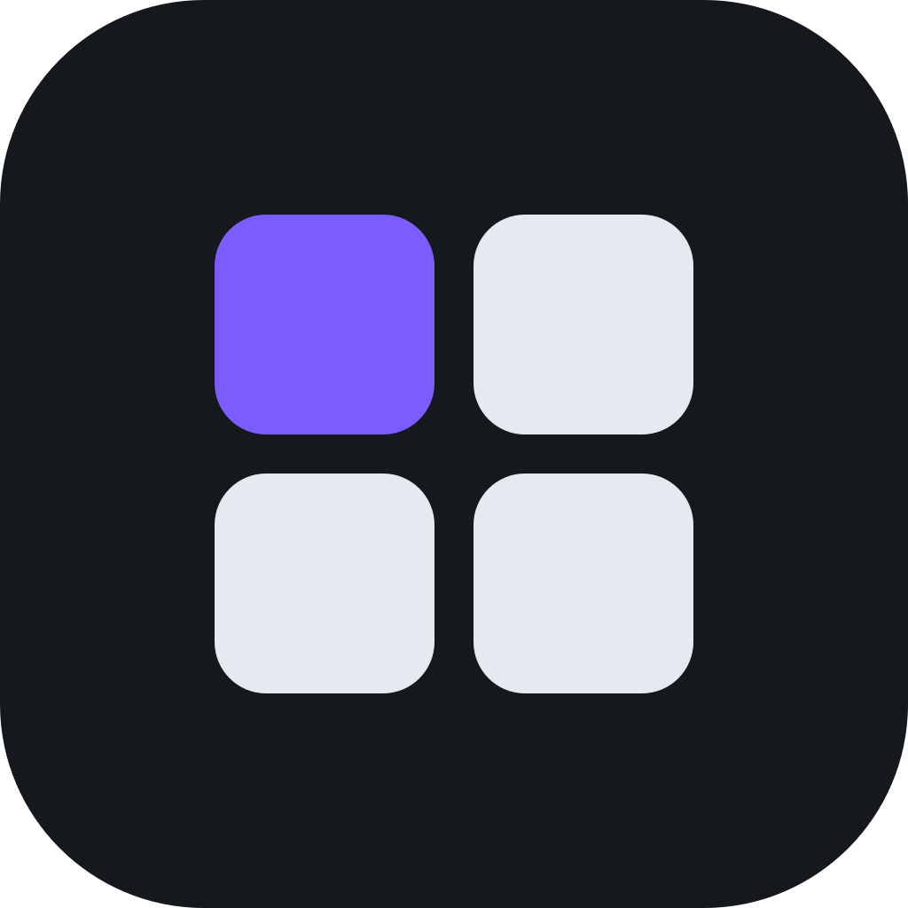
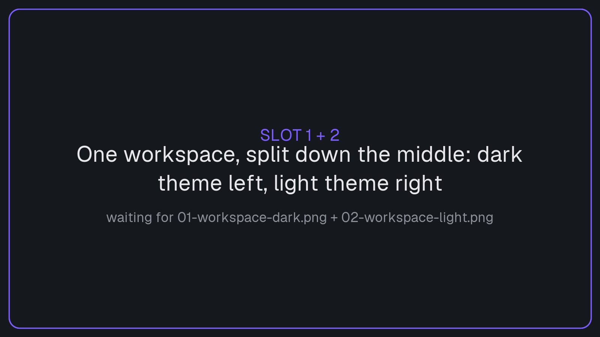
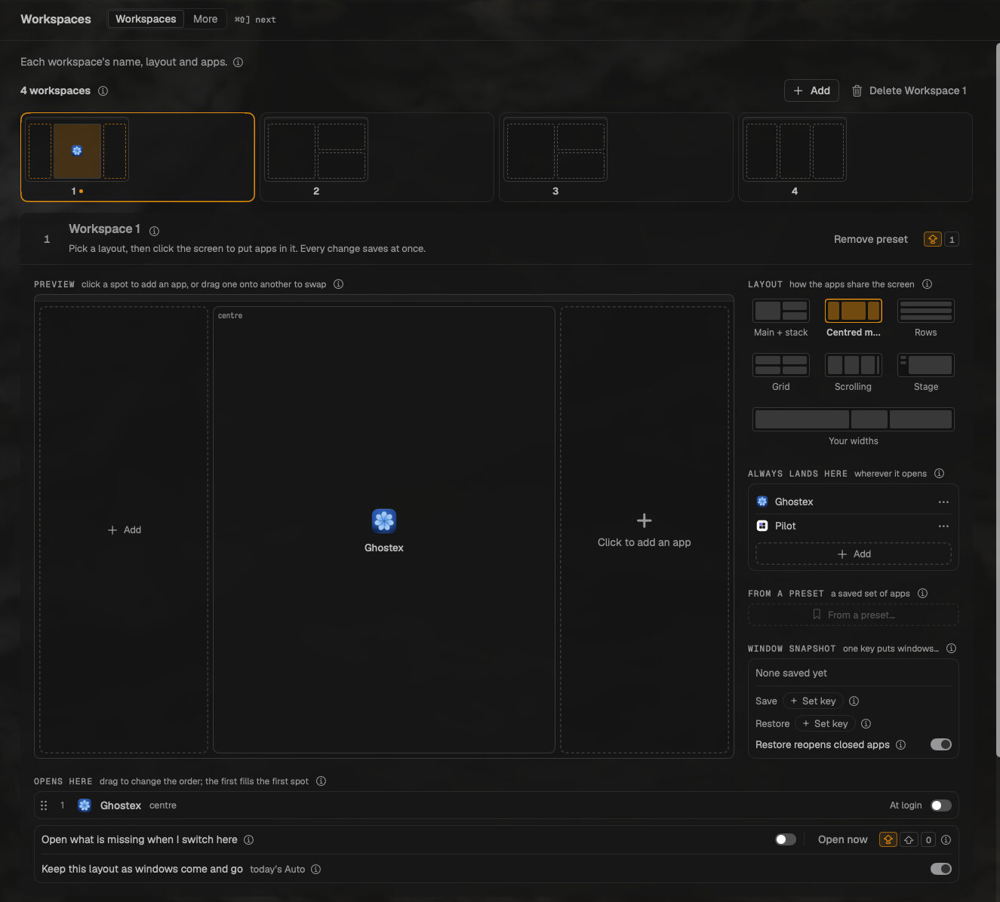
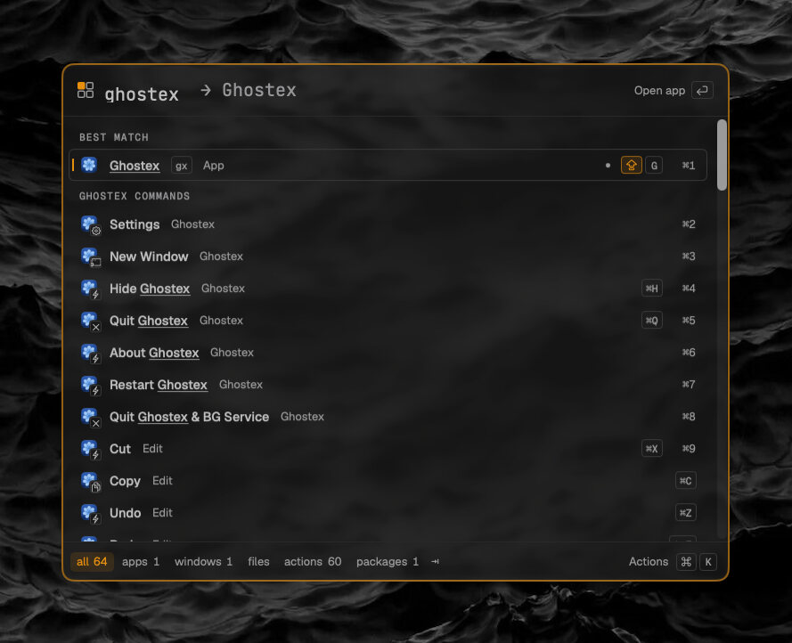
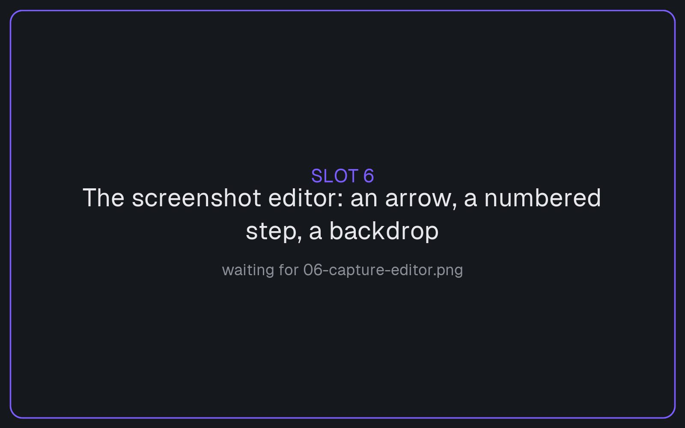

<p align="center">
  <a href="https://pilotformac.com">
    <picture>
      <source media="(prefers-color-scheme: dark)" srcset="site/press/pilot-logo-light.svg" />
      
    </picture>
  </a>
</p>

<h1 align="center">Pilot</h1>

<h3 align="center">Your Mac, your look.<br />A launcher that does the rest.</h3>

<p align="center">
  <s>Tiling&nbsp;manager</s>&nbsp;·
  <s>Launcher</s>&nbsp;·
  <s>Clipboard&nbsp;manager</s>&nbsp;·
  <s>Key&nbsp;remapper</s>&nbsp;·
  <s>Screenshot&nbsp;tool</s>&nbsp;·
  <s>Dictation&nbsp;app</s>&nbsp;·
  <s>File&nbsp;manager</s>&nbsp;·
  <s>File&nbsp;converter</s>&nbsp;·
  <s>Menu&nbsp;bar&nbsp;stats</s>&nbsp;·
  <s>Mac&nbsp;cleaner</s>
</p>

<p align="center"><b>All in one app: Pilot.</b></p>

<p align="center">
  <a href="https://github.com/banozz0/pilot/releases/latest/download/Pilot.dmg"><b>Download</b></a> ·
  <a href="https://pilotformac.com">Website</a> ·
  <a href="https://pilotformac.com/changelog.html">Changelog</a> ·
  <a href="https://github.com/sponsors/banozz0">Sponsor</a>
</p>

<p align="center">
  <a href="https://github.com/banozz0/pilot/releases/latest"></a>
  
  <a href="LICENSE"></a>
</p>

<!-- video 1: Pilot in a minute -->

https://github.com/user-attachments/assets/15dc79b5-5d8e-494b-b20f-ec5d4d398910

## What it does

The keyboard-driven desktop Linux people love, made for the Mac. It runs from Hyper, a key you pick: Caps Lock, or one side of Control, Option or Command.

### 🎨 Your Mac, your look

17 themes built in and 29 packs to get. Apply one and Pilot, your wallpaper and apps like Ghostty, Zed and Obsidian recolour together. [Themes](https://pilotformac.com/look.html) · [Dock](https://pilotformac.com/desktop.html) · [Top bar](https://pilotformac.com/menubar.html)



<p align="center"><sub>One workspace, tiled, in two themes.</sub></p>

### 🪟 Windows tile as they open

Six layouts across nine workspaces, all from the keys. No need to turn off System Integrity Protection. [Windows](https://pilotformac.com/windows.html)



### 🔎 A launcher that does the rest

<kbd>Hyper</kbd>+<kbd>Space</kbd> opens one box for apps, windows, files, settings and answers. Type an app and its own commands come with it. [Launcher](https://pilotformac.com/launcher.html)

<p align="center"></p>

### ⌨️ Your keyboard runs the Mac

Click any key on a picture of your keyboard to give it a job, never in a config file. Hold Hyper to see what every key does. [Keys and binds](https://pilotformac.com/keys.html)

<!-- video 2: Your keyboard runs the Mac -->

https://github.com/user-attachments/assets/1e7e2e1f-fde0-417b-bd84-2cade22a23e4

### 📋 Clipboard and notes

<kbd>Hyper</kbd>+<kbd>V</kbd> shows everything you copied, kept on your Mac and searched in plain words. <kbd>Hyper</kbd>+<kbd>N</kbd> opens a quick note. [Clipboard](https://pilotformac.com/clipboard.html) · [Notes](https://pilotformac.com/notes.html)

### 📸 Captures

<kbd>Hyper</kbd>+<kbd>S</kbd> captures an area and opens an editor: arrows, text, blur, numbered steps, a backdrop. <kbd>Hyper</kbd>+<kbd>R</kbd> records the screen. [Captures](https://pilotformac.com/captures.html)



### ✨ AI and dictation

<kbd>Hyper</kbd>+<kbd>Q</kbd> opens an AI chat on the Claude or ChatGPT plan you already pay for, or Ollama on your Mac. Hold a key and talk: a speech model on your Mac types it. [AI](https://pilotformac.com/ai.html) · [Dictation](https://pilotformac.com/dictation.html)

### 📁 Files

<kbd>Hyper</kbd>+<kbd>F</kbd> opens Pilot Files: folder sizes, <kbd>⌘</kbd>+<kbd>K</kbd> on every file and undo for every action. File search finds a file through a typo. [Pilot Files](https://pilotformac.com/pilotfiles.html) · [File search](https://pilotformac.com/files.html)

**Also in the box:** [Update and Clean](https://pilotformac.com/update.html) · [web apps](https://pilotformac.com/webapps.html) · [extensions](https://pilotformac.com/extensions.html) · a drop-down terminal · [menu bar stats](https://pilotformac.com/menubar.html) · the `pilot` command.

<p align="center"><a href="https://pilotformac.com/#features"><b>Everything Pilot does, a key at a time</b></a></p>

<p align="center"><sub>No account, no analytics and no crash reporting. <a href="https://pilotformac.com/privacy.html">Privacy</a></sub></p>

## Install

1. [Download `Pilot.dmg`](https://github.com/banozz0/pilot/releases/latest/download/Pilot.dmg), open it and drag Pilot
   to Applications.
2. Open Pilot. macOS asks once whether to open an app downloaded from the Internet: click **Open**.
3. Pick your Hyper key in Pilot's setup and allow Accessibility. Hyper+Space opens the menu.

Signed with a Developer ID and notarized by Apple. Updates install from inside Pilot.

<details>
<summary>Permissions and checking the download</summary>

- **Accessibility:** Pilot needs it to see your keys and move windows; nothing works without it.
- **Full Disk Access** for file search in the menu, and **System Events** for sleep, restart and dark mode.
- **Microphone** for dictation and an **AI provider** for the AI chat, both optional.
- **Input Monitoring** only if Pilot asks, when you bind a mouse's media buttons.
- **Screen Recording** when you first take a screenshot or recording, or turn on Menu bar › Other apps › Show exact
  menu bar items. macOS applies it after Pilot reopens: click Quit & Reopen.

Caps Lock as Hyper: tapped alone it is Escape, and Shift+Caps Lock still types capitals. Password fields are blind to
every key tap on macOS, Pilot's included: your binds do not work while one has focus.

Updates keep the permissions you gave. Check the download against the `.sha256` beside it on the Releases page:
`shasum -a 256 -c Pilot.dmg.sha256`.
</details>

## Build from source

<details>
<summary>Xcode 27, Zig, Rust and Python 3: three commands</summary>

Needs Xcode 27 with its Metal toolchain (`xcodebuild -downloadComponent MetalToolchain`),
[Zig](https://ziglang.org/download/) at the version Ghostty's tag pins (0.15.2 for v1.3.1), stable
[Rust](https://rustup.rs) and Python 3.

```sh
# libghostty, from Ghostty's source: about 10 minutes the first time
ZIG=/path/to/zig Scripts/build-ghosttykit.sh
# build/Pilot.app, without updates
PILOT_DEV=1 SIGN_ID="<your signing identity>" Scripts/build-app.sh
open build/Pilot.app
```

`build-ghosttykit.sh` finds Zig through `ZIG`, then `zig@0.15` from Homebrew. `build-app.sh` also builds the Rust file
index helper (`Helpers/pilot-files`), the Swift targets and the dictation helper, and fails a release bundle over the
size budget in `Scripts/lean-budgets.json`. A release needs `SPARKLE_ED_KEY`, the public key its updates are signed
with; `PILOT_DEV=1` builds without updates. It also builds the terminal pack (`Scripts/build-terminal-pack.sh`), the
signed libghostty Pilot downloads on the first Hyper+T, into `build/`. `swift build` works on its own; `swift test`'s
terminal suites need libghostty built, and build the pack themselves when it is missing.

`SIGN_ID` defaults to your keychain's one Developer ID Application identity (`Scripts/sign-id.sh`), else the
`Pilot Release` certificate, and stops when that is not in your keychain. Name your own (a
self-signed Code Signing certificate from Keychain Access › Certificate Assistant, or an Apple Development identity),
or sign ad hoc with `SIGN_ID=-`. macOS ties Accessibility and Full Disk Access to the signature: with a real identity
the grants survive every rebuild; with an ad-hoc one, remove Pilot from Privacy & Security › Accessibility (and Full
Disk Access) and allow it again after each rebuild.
</details>

## Licence and credits

MIT ([LICENSE](LICENSE)), built on [AeroSpace](https://github.com/nikitabobko/AeroSpace), [Ghostty](https://ghostty.org) and [Cardinal](Helpers/pilot-files/vendor/cardinal/). Every notice: [NOTICE](NOTICE).

<details>
<summary>Credits: the open source Pilot builds on</summary>

- [AeroSpace](https://github.com/nikitabobko/AeroSpace) (MIT): Pilot's tiler is ported from it.
- [Ghostty](https://ghostty.org) (MIT): libghostty runs the drop-down terminal.
- [Cardinal](Helpers/pilot-files/vendor/cardinal/) (MIT): the file search engine.
- [Sparkle](Packaging/Sparkle-LICENSE.txt): updates.
- Speech and voice: [WhisperKit](Packaging/WhisperKit-NOTICES.txt), [Whisper](Packaging/Whisper-LICENSE.txt),
  [FluidAudio](Packaging/FluidAudio-NOTICES.txt), [Parakeet](Packaging/Parakeet-LICENSE.txt),
  [Kokoro](Packaging/Kokoro-LICENSE.txt).
- [CodexBar](Packaging/CodexBar-LICENSE.txt), [gemoji](Packaging/gemoji-LICENSE.txt),
  [Omarchy](Packaging/Omarchy-LICENSE.txt), [Snapzy](Packaging/Snapzy-LICENSE.txt), and the fonts in
  [Packaging/Fonts](Packaging/Fonts).

Also in the app: General › About › Acknowledgements.

</details>

<p align="center">
  <a href="https://github.com/banozz0/pilot/issues/new/choose">Issues</a> ·
  <a href="CONTRIBUTING.md">Contributing</a> ·
  <a href="https://github.com/sponsors/banozz0">Sponsor</a>
</p>
