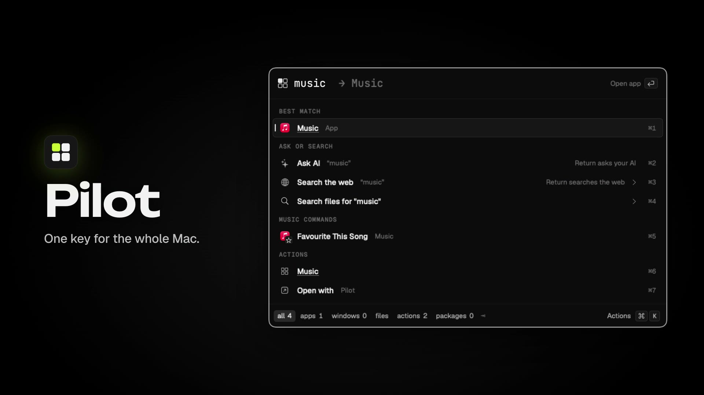

<h1 align="center">Pilot</h1>

<p align="center"><b>Hold Caps Lock. The whole Mac answers.</b></p>

<p align="center">
Tiling, a launcher, clipboard, captures, dictation and AI in one native app, all on one key:<br>
the keyboard-driven desktop Linux people love, made for the Mac.
</p>

<p align="center">
<a href="https://github.com/banozz0/pilot/releases/latest/download/Pilot.dmg"><b>Download Pilot.dmg</b></a>
&nbsp;·&nbsp; <a href="https://pilot-mac.vercel.app">Website</a>
&nbsp;·&nbsp; <a href="https://github.com/banozz0/pilot/releases">Releases</a>
&nbsp;·&nbsp; macOS 27+, Apple silicon &nbsp;·&nbsp; Free, MIT
</p>

<p align="center">
<a href="https://pilot-mac.vercel.app/#film"></a><br>
<sub>▶ Pilot in five minutes: every feature, start to finish. Click to play it on the website.</sub>
</p>

## What it does

Pick a key you rarely use (Caps Lock, or one side of Control, Option or Command). It becomes Hyper, and every key
under it runs whatever you set.

| | Area | What you get | Key |
|---|---|---|---|
| ⌨️ | [Keys and binds](https://pilot-mac.vercel.app/keys.html) | Every key under Hyper does what you set, from one picture of your keyboard. Hold Hyper to see what each key does. | Hyper |
| 🪟 | [Windows and workspaces](https://pilot-mac.vercel.app/windows.html) | Pilot's own tiler arranges every window across nine workspaces, without turning off System Integrity Protection. Columns, rows, grid or scrolling. | `Hyper+1…9` |
| 🔎 | [Launcher](https://pilot-mac.vercel.app/launcher.html) | One search box for apps, windows, files, actions, settings and answers: maths, units, money, time zones, emoji. | `Hyper+Space` |
| 📋 | [Clipboard and notes](https://pilot-mac.vercel.app/clipboard.html) | Everything you copy, kept on your Mac, plus quick notes and snippets that type themselves. | |
| 📸 | [Captures](https://pilot-mac.vercel.app/captures.html) | Screenshots, scrolling captures, screen recordings and text from the screen, with an image and video editor. | |
| 🎙️ | [Dictation and voice](https://pilot-mac.vercel.app/dictation.html) | Talk and Pilot types it, with a speech model running on your Mac. Read aloud speaks selected text back. | Your pick |
| ✨ | [AI](https://pilot-mac.vercel.app/ai.html) | An AI chat on the plan you already pay for, and AI on any text you select. | `Hyper+Q` |
| 🌐 | [Web apps](https://pilot-mac.vercel.app/webapps.html) | Turn a site into a small Mac app with its own Dock icon, Cmd+Tab entry and logins. | |
| 🧩 | [Extensions](https://pilot-mac.vercel.app/extensions.html) | Add commands from the catalogue or build your own, and drive Pilot from a terminal or an agent. | |
| 📊 | [Menu bar and top bar](https://pilot-mac.vercel.app/menubar.html) | Pilot's icon in the menu bar, or a top bar of its own in place of macOS's, and a terminal that drops from it. | `Hyper+T` |

No key listed? Type the feature's name in Hyper+Space, or give it one on the Binds page. Also in the box: file search
and convert, Mac controls and stats, app install, update and clean, and the `pilot` command.
[All 179 features](https://pilot-mac.vercel.app/#features).

No analytics and no crash reporting. File search, dictation, read aloud and translate run on your Mac; AI goes only to
the provider you pick.

## Install

1. [Download `Pilot.dmg`](https://github.com/banozz0/pilot/releases/latest/download/Pilot.dmg), open it and drag Pilot
   to Applications.
2. Open Pilot. macOS says Apple could not verify it, because Pilot is open source and not notarized: click Done. Within
   the hour, open System Settings › Privacy & Security, click **Open Anyway** beside Pilot and enter your login password.
3. Pick your Hyper key in Pilot's setup and allow Accessibility. Hyper+Space opens the menu.

Updates install from inside Pilot, signed with the same certificate, so the warning never comes back and your
permissions stay.

<details>
<summary>Permissions, the Terminal route and checking the download</summary>

- **Accessibility:** Pilot needs it to see your keys and move windows; nothing works without it.
- **Full Disk Access** for file search in the menu, and **System Events** for sleep, restart and dark mode.
- **Microphone** for dictation and an **AI provider** for the AI chat, both optional.
- **Input Monitoring** only if Pilot asks, when you bind a mouse's media buttons.
- **Screen Recording** when you first take a screenshot or recording, or turn on Menu bar › Other apps › Show exact
  menu bar items. macOS applies it after Pilot reopens: click Quit & Reopen.

Caps Lock as Hyper: tapped alone it is Escape, and Shift+Caps Lock still types capitals. Password fields are blind to
every key tap on macOS, Pilot's included: your binds do not work while one has focus.

From Terminal instead of step 2: `xattr -dr com.apple.quarantine /Applications/Pilot.app`. Check the download against
the `.sha256` beside it on the Releases page: `shasum -a 256 -c Pilot.dmg.sha256`.
</details>

## Build from source

Needs Xcode 27 with its Metal toolchain (`xcodebuild -downloadComponent MetalToolchain`),
[Zig](https://ziglang.org/download/) at the version Ghostty's tag pins (0.15.2 for v1.3.1), stable
[Rust](https://rustup.rs) and Python 3.

```sh
# libghostty, from Ghostty's source: about 10 minutes the first time
ZIG=/path/to/zig Scripts/build-ghosttykit.sh
# build/Pilot.app, without updates
PILOT_DEV=1 SIGN_ID="<your signing identity>" Scripts/build-app.sh
open build/Pilot.app
```

<details>
<summary>What the scripts do, and signing</summary>

`build-ghosttykit.sh` finds Zig through `ZIG`, then `zig@0.15` from Homebrew. `build-app.sh` also builds the Rust file
index helper (`Helpers/pilot-files`), the Swift targets and the dictation helper, and fails a release bundle over the
size budget in `Scripts/lean-budgets.json`. A release needs `SPARKLE_ED_KEY`, the public key its updates are signed
with; `PILOT_DEV=1` builds without updates. `swift build` and `swift test` work on their own once libghostty is built.

`SIGN_ID` defaults to the `Pilot Release` certificate and stops when it is not in your keychain. Name your own (a
self-signed Code Signing certificate from Keychain Access › Certificate Assistant, or an Apple Development identity),
or sign ad hoc with `SIGN_ID=-`. macOS ties Accessibility and Full Disk Access to the signature: with a real identity
the grants survive every rebuild; with an ad-hoc one, remove Pilot from Privacy & Security › Accessibility (and Full
Disk Access) and allow it again after each rebuild.
</details>

## Licence and credits

Pilot is MIT-licensed ([LICENSE](LICENSE)). Contributions: [CONTRIBUTING.md](CONTRIBUTING.md). It builds on:

- [AeroSpace](https://github.com/nikitabobko/AeroSpace) (MIT): Pilot's tiler is ported from it.
- [Ghostty](https://ghostty.org) (MIT): libghostty runs the drop-down terminal.
- [Cardinal](Helpers/pilot-files/vendor/cardinal/) (MIT): the file search engine.
- [Sparkle](Packaging/Sparkle-LICENSE.txt): updates.
- Speech and voice: [WhisperKit](Packaging/WhisperKit-NOTICES.txt), [Whisper](Packaging/Whisper-LICENSE.txt),
  [FluidAudio](Packaging/FluidAudio-NOTICES.txt), [Parakeet](Packaging/Parakeet-LICENSE.txt),
  [Kokoro](Packaging/Kokoro-LICENSE.txt).
- Images: [Real-ESRGAN](Packaging/Real-ESRGAN-LICENSE.txt), [RealESRGAN-CoreML](Packaging/RealESRGAN-CoreML-LICENSE.txt).
- [CodexBar](Packaging/CodexBar-LICENSE.txt), [gemoji](Packaging/gemoji-LICENSE.txt),
  [Omarchy](Packaging/Omarchy-LICENSE.txt), [Snapzy](Packaging/Snapzy-LICENSE.txt), and the fonts in
  [Packaging/Fonts](Packaging/Fonts).

Third-party code, assets and trademarks in full: [NOTICE](NOTICE), and General › About › Acknowledgements in the app.
