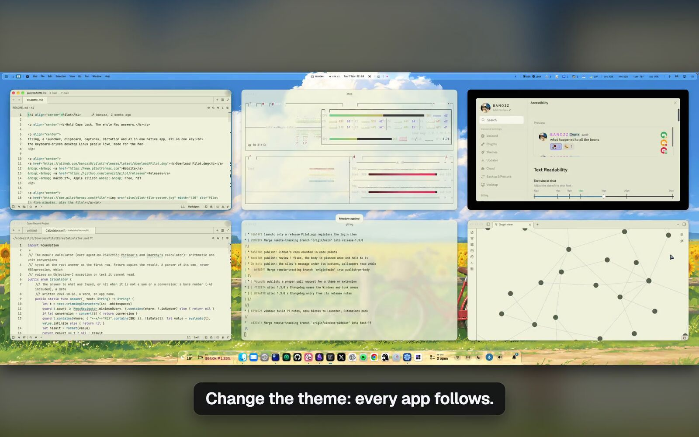
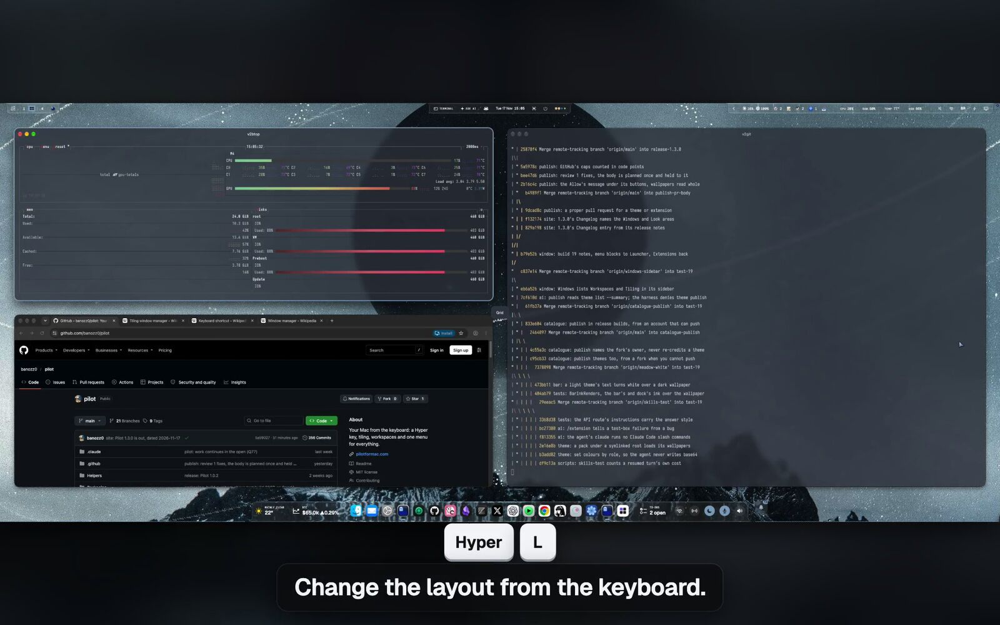
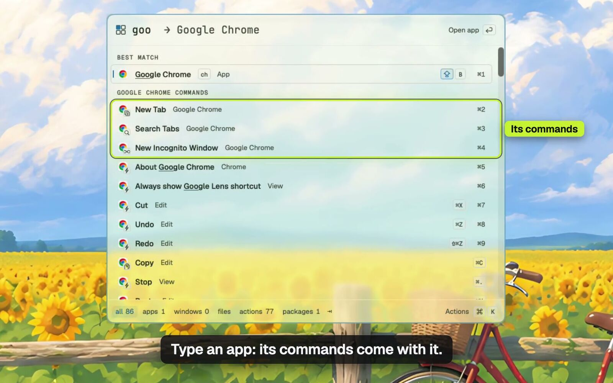

<p align="center">
  <a href="https://pilotformac.com"></a>
</p>

<h1 align="center">Pilot</h1>

<h3 align="center">Your Mac, your look.<br />A launcher that does the rest.</h3>

<p align="center">
  <s>Tiling&nbsp;manager</s>&nbsp;·
  <s>Launcher</s>&nbsp;·
  <s>Clipboard&nbsp;manager</s>&nbsp;·
  <s>Key&nbsp;remapper</s>&nbsp;·
  <s>Screenshot&nbsp;tool</s>&nbsp;·
  <s>Dictation&nbsp;app</s>&nbsp;·
  <s>File&nbsp;manager</s>&nbsp;·
  <s>File&nbsp;converter</s>&nbsp;·
  <s>System&nbsp;monitor</s>&nbsp;·
  <s>Mac&nbsp;cleaner</s>
</p>

<p align="center"><b>All in one app: Pilot.</b></p>

<p align="center">
  <a href="https://github.com/banozz0/pilot/releases/latest/download/Pilot.dmg"><b>Download</b></a> ·
  <a href="https://pilotformac.com">Website</a> ·
  <a href="https://pilotformac.com/changelog.html">Changelog</a> ·
  <a href="https://github.com/sponsors/banozz0">Sponsor</a>
</p>

<p align="center">macOS 27 or later · Apple silicon<br />Free and open source · MIT</p>

<!-- video 1: Pilot in a minute -->

https://github.com/user-attachments/assets/ed72725e-d60d-4e99-8864-794a24263009

## What it does

The keyboard-driven desktop Linux people love, made for the Mac. Pick a key you rarely use: Caps Lock, or one side of Control, Option or Command. It becomes Hyper, and every key under it runs what you set.

### 🎨 Your Mac, your look

19 themes built in and 31 packs to get. Apply one and Pilot, your wallpaper and the apps it finds recolour together: Ghostty, Zed, Obsidian and more. Add a dock and a top bar of your own, with widgets. [Look](https://pilotformac.com/look.html) · [Desktop](https://pilotformac.com/desktop.html) · [Top bar](https://pilotformac.com/menubar.html)

<details>
<summary>See a theme change</summary>



</details>

### 🪟 Windows tile as they open

Pilot's own tiler arranges every window across nine workspaces, without turning off System Integrity Protection. Six layouts, focus, swap and resize from the keys, and `Hyper+1…9` jumps to a workspace. [Windows](https://pilotformac.com/windows.html)

<details>
<summary>See tiling</summary>



</details>

### 🔎 A launcher that does the rest

`Hyper+Space` opens one search box for apps, windows, files, actions, settings and answers: maths, units, money, time zones, emoji. Type an app and its own commands come with it. [Launcher](https://pilotformac.com/launcher.html)

<details>
<summary>See the launcher</summary>



</details>

### ⌨️ Your keyboard runs the Mac

Give any key a job by clicking it on a picture of your keyboard, never in a config file. Hold Hyper and a panel shows what every key does. [Keys and binds](https://pilotformac.com/keys.html)

<!-- video 2: Your keyboard runs the Mac -->

https://github.com/user-attachments/assets/39581434-7de8-477b-b96d-850946f28812

### 📋 Clipboard, notes and snippets

`Hyper+V` shows everything you copy, kept on your Mac and searched in plain words. `Hyper+N` opens a quick note, and snippets type themselves from a keyword. [Clipboard](https://pilotformac.com/clipboard.html) · [Notes](https://pilotformac.com/notes.html)

### 📸 Captures

`Hyper+S` captures an area and opens an editor: arrows, text, blur, numbered steps, a backdrop. `Hyper+R` records the screen, then you cut and speed up the recording. Scrolling captures and text from the screen too. [Captures](https://pilotformac.com/captures.html)

### ✨ AI and dictation

`Hyper+Q` opens an AI chat on the Claude or ChatGPT plan you already pay for, your own API key, or Ollama on the Mac. Hold a key and talk: Pilot types it, with a speech model running on your Mac. [AI](https://pilotformac.com/ai.html) · [Dictation](https://pilotformac.com/dictation.html)

### 📁 Files

`Hyper+F` opens Pilot Files, a file window of its own: folder sizes, `⌘K` on every file and undo for every action. Find a file through a typo, and convert one with a right-click. [Pilot Files](https://pilotformac.com/pilotfiles.html) · [File search](https://pilotformac.com/files.html) · [Convert](https://pilotformac.com/convert.html)

**Also in the box:** [Update and Clean](https://pilotformac.com/update.html), every upgrade previewed first · [web apps](https://pilotformac.com/webapps.html) with their own Dock icon · [extensions](https://pilotformac.com/extensions.html) from the catalogue, or built by Pilot's AI · a drop-down terminal on `Hyper+T` · [Mac stats](https://pilotformac.com/stats.html) · the `pilot` command for scripts and agents.

No key listed? Type the feature's name in Hyper+Space, or give it one on the Binds page. [Everything Pilot does, a key at a time](https://pilotformac.com/#features).

No account, no analytics and no crash reporting. File search, dictation, read aloud and translate run on your Mac; AI goes only to the provider you pick. [Privacy](https://pilotformac.com/privacy.html)

## Install

1. [Download `Pilot.dmg`](https://github.com/banozz0/pilot/releases/latest/download/Pilot.dmg), open it and drag Pilot
   to Applications.
2. Open Pilot. macOS asks once whether to open an app downloaded from the Internet: click **Open**.
3. Pick your Hyper key in Pilot's setup and allow Accessibility. Hyper+Space opens the menu.

Pilot is signed with Apple's Developer ID and notarized by Apple. Updates install from inside Pilot and keep your
permissions.

<details>
<summary>Permissions and checking the download</summary>

- **Accessibility:** Pilot needs it to see your keys and move windows; nothing works without it.
- **Full Disk Access** for file search in the menu, and **System Events** for sleep, restart and dark mode.
- **Microphone** for dictation and an **AI provider** for the AI chat, both optional.
- **Input Monitoring** only if Pilot asks, when you bind a mouse's media buttons.
- **Screen Recording** when you first take a screenshot or recording, or turn on Menu bar › Other apps › Show exact
  menu bar items. macOS applies it after Pilot reopens: click Quit & Reopen.

Caps Lock as Hyper: tapped alone it is Escape, and Shift+Caps Lock still types capitals. Password fields are blind to
every key tap on macOS, Pilot's included: your binds do not work while one has focus.

Check the download against the `.sha256` beside it on the Releases page: `shasum -a 256 -c Pilot.dmg.sha256`.
</details>

## Build from source

Needs Xcode 27 with its Metal toolchain (`xcodebuild -downloadComponent MetalToolchain`),
[Zig](https://ziglang.org/download/) at the version Ghostty's tag pins (0.15.2 for v1.3.1), stable
[Rust](https://rustup.rs) and Python 3.

```sh
# libghostty, from Ghostty's source: about 10 minutes the first time
ZIG=/path/to/zig Scripts/build-ghosttykit.sh
# build/Pilot.app, without updates
PILOT_DEV=1 SIGN_ID="<your signing identity>" Scripts/build-app.sh
open build/Pilot.app
```

<details>
<summary>What the scripts do, and signing</summary>

`build-ghosttykit.sh` finds Zig through `ZIG`, then `zig@0.15` from Homebrew. `build-app.sh` also builds the Rust file
index helper (`Helpers/pilot-files`), the Swift targets and the dictation helper, and fails a release bundle over the
size budget in `Scripts/lean-budgets.json`. A release needs `SPARKLE_ED_KEY`, the public key its updates are signed
with; `PILOT_DEV=1` builds without updates. It also builds the terminal pack (`Scripts/build-terminal-pack.sh`), the
signed libghostty Pilot downloads on the first Hyper+T, into `build/`. `swift build` works on its own; `swift test`'s
terminal suites need libghostty built, and build the pack themselves when it is missing.

`SIGN_ID` defaults to your keychain's one Developer ID Application identity (`Scripts/sign-id.sh`), else the
`Pilot Release` certificate, and stops when that is not in your keychain. Name your own (a
self-signed Code Signing certificate from Keychain Access › Certificate Assistant, or an Apple Development identity),
or sign ad hoc with `SIGN_ID=-`. macOS ties Accessibility and Full Disk Access to the signature: with a real identity
the grants survive every rebuild; with an ad-hoc one, remove Pilot from Privacy & Security › Accessibility (and Full
Disk Access) and allow it again after each rebuild.
</details>

## Help and contributing

[Issues](https://github.com/banozz0/pilot/issues/new/choose) for bugs and ideas · [Contributing](CONTRIBUTING.md) for code, themes and extensions · [Sponsor](https://github.com/sponsors/banozz0) to support Pilot.

## Licence and credits

Pilot is MIT-licensed ([LICENSE](LICENSE)). Its tiler is ported from [AeroSpace](https://github.com/nikitabobko/AeroSpace) (MIT), [Ghostty](https://ghostty.org)'s libghostty runs the drop-down terminal, and file search is [Cardinal](Helpers/pilot-files/vendor/cardinal/)'s engine.

<details>
<summary>Credits: the open source Pilot builds on</summary>

- [AeroSpace](https://github.com/nikitabobko/AeroSpace) (MIT): Pilot's tiler is ported from it.
- [Ghostty](https://ghostty.org) (MIT): libghostty runs the drop-down terminal.
- [Cardinal](Helpers/pilot-files/vendor/cardinal/) (MIT): the file search engine.
- [Sparkle](Packaging/Sparkle-LICENSE.txt): updates.
- Speech and voice: [WhisperKit](Packaging/WhisperKit-NOTICES.txt), [Whisper](Packaging/Whisper-LICENSE.txt),
  [FluidAudio](Packaging/FluidAudio-NOTICES.txt), [Parakeet](Packaging/Parakeet-LICENSE.txt),
  [Kokoro](Packaging/Kokoro-LICENSE.txt).
- Images: [Real-ESRGAN](Packaging/Real-ESRGAN-LICENSE.txt), [RealESRGAN-CoreML](Packaging/RealESRGAN-CoreML-LICENSE.txt).
- [CodexBar](Packaging/CodexBar-LICENSE.txt), [gemoji](Packaging/gemoji-LICENSE.txt),
  [Omarchy](Packaging/Omarchy-LICENSE.txt), [Snapzy](Packaging/Snapzy-LICENSE.txt), and the fonts in
  [Packaging/Fonts](Packaging/Fonts).

</details>

Third-party code, assets and trademarks in full: [NOTICE](NOTICE), and General › About › Acknowledgements in the app.
